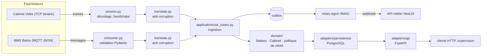

# Note d'architecture — fanga-ingest

## 1. Connectivité

### Cabinets Voltix (TCP)

Le cabinet ouvre la connexion vers notre serveur (le serveur n'initie
jamais), envoie `LOGIN`, puis ses trames au fil des événements. Fanga a
confirmé que les cabinets passent par l'Internet public : il n'y a donc
aucune garantie de réseau privé à ce stade du projet.

**Identification.** Un cabinet s'identifie par l'identifiant ASCII porté
dans `LOGIN`. Nous le comparons à une liste blanche (`VOLTIX_ALLOWED_CABINET_IDS`,
variable d'environnement) : un identifiant absent de la liste reçoit un ACK
d'erreur et la connexion est fermée. **Il n'y a pas d'authentification au
sens strict** — pas de secret, pas de certificat — seule la connaissance de
l'identifiant suffit à se faire passer pour un cabinet. C'est le point le
plus faible de la chaîne de sécurité actuelle.

**Durcissement recommandé, par ordre de priorité :**
1. **TLS** sur le port TCP — nous l'avons demandé à Voltix (voir
   `docs/livrable-3-voltix.md`, question 13) ; ce n'est pas prévu par leur
   documentation actuelle.
2. **APN privé** (réseau mobile dédié, invisible depuis l'Internet public) à
   partir d'une certaine échelle — recommandé dès que le déploiement dépasse
   une centaine de cabinets (donc avant les 300 cabinets visés à 18 mois) :
   le coût d'un APN privé auprès d'un opérateur devient proportionnellement
   plus raisonnable, et il élimine la surface d'attaque réseau plutôt que de
   la limiter.
3. **Pare-feu applicatif** : limiter le taux de nouvelles connexions par IP,
   fermer après un délai d'inactivité (déjà fait, 180 s) et après des trames
   invalides répétées (déjà fait, 10 trames).

**Ajouter un cabinet** ne demande qu'une entrée de plus dans la liste
blanche (configuration, pas de déploiement de code).

### Batteries Batrix (MQTT)

Le broker MQTT **fait partie de notre proposition** (confirmé par Fanga) :
Mosquitto en conteneur, radicalement simple à opérer pour ce volume (voir
section 3). Chaque batterie publie sur `batrix/v1/{numero_serie}/telemetry`.

**En démo**, le broker accepte les connexions anonymes — c'est documenté
comme tel dans `deploy/mosquitto/mosquitto.conf` et ne doit jamais aller en
production. La configuration de référence (`deploy/mosquitto/mosquitto.prod.conf`,
non utilisée par le compose de démo) prévoit :
- un listener TLS (port 8883) ;
- `allow_anonymous false` avec un fichier de mots de passe ;
- une ACL (`acl_file`) où chaque batterie ne peut publier que sur son propre
  topic (`pattern write batrix/v1/%u/telemetry`) — une batterie compromise
  ne peut donc pas usurper l'identité d'une autre ;
- un compte de service, utilisé par `fanga-ingest`, en lecture sur tout le
  namespace (`batrix/#`).

### Ajouter un fournisseur

Le domaine et les cas d'usage ne connaissent que trois observations
canoniques (`SlotObserved`, `SwapObserved`, `TelemetryObserved`). Un nouveau
fournisseur n'a besoin que d'un nouveau dossier `adapters/vendors/<nom>/`
(son propre décodage + sa propre traduction anti-corruption vers ces trois
types) et d'une entrée dans `main.py`. Zéro ligne modifiée dans le domaine,
les cas d'usage, les dépôts PostgreSQL ou les routes API — démontré dans le
code par la coexistence actuelle de Voltix (TCP binaire) et Batrix (MQTT
JSON), deux transports et deux formats radicalement différents qui
convergent vers le même contrat.

## 2. Consolidation

### Qui fait foi, pour quoi

| Donnée | Source de vérité | Règle |
|---|---|---|
| Localisation, état du casier | Cabinet (Voltix) uniquement | La mesure la plus récente gagne (`observed_at`). Un SWAP_EVENT met le casier de dépôt en `occupied`, celui de retrait en `empty`. |
| SOC, tension, températures | Les deux sources, en compétition | Clé d'ordre total : `observed_at` (+ 3 min si source BMS), puis source. Le BMS gagne sauf si le cabinet est plus récent de plus de 3 minutes. |
| Cycles, état électrique (CHG/DSG/IDLE/ERR), erreurs | BMS (Batrix) uniquement | Pas de compétition : le cabinet ne les rapporte pas. |
| Défaut | Union des deux sources | Casier en défaut **ou** BMS en erreur ⇒ batterie en défaut. Un seul événement par passage à l'état défectueux. |

La clé d'ordre total pour l'état électrique est le point le plus important
à savoir expliquer : elle rend le résultat final **indépendant de l'ordre
d'arrivée**. Que le cabinet et le BMS arrivent dans un ordre ou dans l'autre,
on retient toujours la mesure dont la clé est la plus grande — jamais celle
qui est arrivée en dernier. Testé explicitement (20 ordres aléatoires,
même résultat).

### Doublons, désordre, horloges

- **Doublons** : chaque observation porte une `dedup_key` (unique en base).
  `INSERT ... ON CONFLICT DO NOTHING` : pas de nouvelle ligne, donc aucun
  effet côté domaine. Fonctionne pour une retransmission MQTT QoS 1 comme
  pour une trame Voltix rejouée après une coupure.
- **Désordre** : un message BMS plus ancien que la dernière mesure déjà
  retenue est ignoré (comparaison stricte des horodatages, jamais de
  régression).
- **Horloges** : `SLOT_STATUS` ne porte pas d'horodatage propre → daté à
  réception. L'horodatage d'un `SWAP_EVENT` (horloge du cabinet) n'est
  retenu que s'il est à moins de 5 minutes de l'heure serveur ; au-delà, on
  retient l'heure serveur et on logue la dérive — l'horloge d'un cabinet sur
  le terrain n'est jamais pleinement fiable.

### Batterie inconnue

Une batterie jamais vue n'est **ni rejetée, ni ajoutée à l'inventaire** :
elle est créée en quarantaine (`in_inventory = false`), ses observations
sont conservées normalement, et un événement `battery.unknown_detected` est
émis une seule fois. L'API métier Fanga fait référence : `POST
/internal/inventory/batteries` (section 4) lève la quarantaine sans perdre
l'historique déjà accumulé.

### Écart entre sources

Si le cabinet et le BMS rapportent un SOC différent de plus de 5 points à
moins de 3 minutes d'intervalle, un événement `battery.soc_discrepancy` est
émis — utile pour détecter un capteur cabinet mal calibré ou un défaut de
contact, sans pour autant bloquer l'affichage (on continue d'appliquer la
règle de la clé d'ordre total pour savoir quelle valeur afficher).

### Application aux données du document

En rejouant les trames Voltix et les messages Batrix du document (section 4
du brief) dans n'importe quel ordre, l'état final de **BT004817** est :

- **Localisation** : hors cabinet. La dernière information de localisation
  vient du `SWAP_EVENT` (source cabinet) : elle a été retirée du casier 3 à
  08:00:00 (horloge cabinet, acceptée car à moins de 5 minutes de l'heure
  serveur).
- **SOC : 91,8 %, source `batrix`, mesuré à 08:01:00.** Le cabinet avait
  rapporté 96 % à 07:59:49 (clé : `07:59:49`, source `voltix`) ; le BMS a
  rapporté 92,0 % à 07:59:00 puis 91,8 % à 08:01:00 (clé : `08:01:00 + 3 min
  = 08:04:00`, source `batrix`). La clé la plus grande est celle du BMS à
  08:01:00 : c'est elle qui gagne, **quel que soit l'ordre dans lequel ces
  trois mesures sont traitées.**
- **Écart cabinet/BMS** : 96 % contre 92,0 % à 49 secondes d'intervalle, soit
  4 points — sous le seuil de 5, aucun événement `battery.soc_discrepancy`.

Les autres batteries du document suivent les mêmes règles sans surprise :
BT002290 en défaut (les deux sources sont d'accord, un seul événement),
BT001977 et BT003105 dans leurs casiers avec un SOC qui vient de la seule
source disponible (BMS pour l'une, cabinet pour l'autre — faute de BMS),
BT009999 en quarantaine, BT000555 absente (sa trame a un CRC invalide,
rejetée avant de produire la moindre observation).

## 3. Infrastructure

### Dimensionnement

Le trafic est dominé par la télémétrie Batrix (une publication par batterie
toutes les 60 secondes) :

| Échéance | Cabinets | Batteries | Télémétrie Batrix | Lignes/jour (ordre de grandeur) |
|---|---|---|---|---|
| Démarrage | 40 | 600 | ~10 messages/s | ~0,9 million |
| 18 mois | 300 | 5 000 | ~83 messages/s | ~7,2 millions |

Volume largement à la portée d'une seule instance PostgreSQL correctement
indexée. Deux tables grandissent sans borne si on ne fait rien :

- **`observations`** (dédoublonnage uniquement, aucune valeur métier au-delà)
  : purge recommandée des lignes de plus de quelques jours (une tâche cron
  ou un `DELETE ... WHERE created_at < now() - interval '7 days'` planifié
  suffit — la fenêtre de déduplication utile se compte en minutes, pas en
  mois).
- **`outbox`** : les lignes publiées (`published_at` non nul) peuvent être
  purgées après quelques jours de la même façon, une fois qu'on est certain
  que NestJS les a bien reçues.

**`batteries`/`cabinets`** ne stockent que l'état *courant* (pas
d'historique complet), donc leur taille reste proportionnelle au nombre de
batteries/cabinets, pas au volume de télémétrie — pas de partitionnement
nécessaire à cette échelle. Si Fanga veut conserver l'historique complet des
mesures (pas seulement l'état consolidé courant), une table d'historique
partitionnée par jour, ou une extension comme TimescaleDB, deviendrait
pertinente — ce n'est pas un besoin exprimé dans l'énoncé, donc non
implémenté ici (liste « avec plus de temps »).

### Hébergement et budget

VPS en Europe (Hetzner, Scaleway ou OVH — même ordre de prix), Docker
Compose comme aujourd'hui, pas d'orchestrateur : à cette échelle,
Kubernetes ajouterait de la complexité opérationnelle sans bénéfice réel
(voir `me.md` pour le détail de cet arbitrage). Budget de référence, **à
vérifier auprès du fournisseur retenu** :

| Poste | Estimation |
|---|---|
| VPS (4 vCPU / 8 Go au démarrage, 8 vCPU / 16 Go à 18 mois) | ~15–25 $/mois → ~40–55 $/mois |
| Sauvegardes / snapshots | ~4–6 $/mois |
| Stockage objet pour l'archivage WAL (optionnel) | ~1–2 $/mois |
| Certificat TLS | gratuit (Let's Encrypt) |
| **Total** | **~20–30 $/mois au démarrage, ~45–65 $/mois à 18 mois** |

Reste sous le budget de 100 $/mois indiqué par le brief, avec de la marge.

### Environnements et CI/CD

Trois environnements, un par branche (`dev`, `preprod`, `production`), même
`docker-compose.yml`, bases de données séparées. `ci.yml` (lint, types,
tests avec couverture, build Docker) tourne sur les trois branches ;
`cd.yml` (E2E réel, publication GHCR, déploiement) ne tourne que sur
`preprod` et `production`, avec un environnement GitHub nommé par branche
pour l'approbation manuelle en production.

### Sauvegardes

PostgreSQL en archivage continu des WAL (`archive_mode = on`) vers un
stockage objet, avec une sauvegarde de base (`pg_basebackup`) quotidienne.
**RPO cible : 5 minutes** (fréquence d'expédition des WAL). Restauration à
tester régulièrement sur une instance jetable (par exemple mensuellement) —
une sauvegarde qu'on n'a jamais essayé de restaurer n'est qu'une hypothèse.

### Sécurité et supervision

Sécurité réseau détaillée en section 1. Supervision : `last_seen_at` mis à
jour à chaque trame cabinet (HEARTBEAT compris), tâche périodique (30 s) qui
déclare un cabinet hors ligne après 180 s de silence et émet
`cabinet.offline` (puis `cabinet.online` dès la trame suivante). `/metrics`
au format Prometheus expose ces compteurs et jauges. **Avec plus de
temps** : brancher un Grafana sur ces métriques et une alerte (Slack,
PagerDuty) sur `cabinet.offline` — aujourd'hui l'événement est émis mais
rien ne le relaie activement vers un humain.

### Si une contrainte de localisation des données s'appliquait

Fanga a indiqué qu'aucune contrainte de localisation ne s'applique pour
l'instant, mais a demandé qu'on signale si la proposition changerait dans le
cas contraire. Une obligation de garder les données en Côte d'Ivoire ou au
Bénin nous ferait renoncer à un VPS européen générique au profit d'un
fournisseur avec présence régionale (par exemple une région cloud africaine
chez un grand fournisseur, ou un hébergeur local) — probablement plus
coûteux et avec moins de choix d'outils managés, mais avec un bénéfice
réel : une latence réseau plus faible pour des équipements situés sur
place.

## 4. Intégration à la plateforme NestJS

**Mécanisme retenu : outbox + webhook signé.** Chaque cas d'usage écrit ses
événements dans une table `outbox`, dans la **même transaction** que la
mise à jour de l'agrégat concerné — donc jamais d'événement perdu ni
d'événement fantôme (écrit sans que l'état correspondant ait été persisté,
ou l'inverse). Un relais asyncio séparé lit cette table (`SELECT ... FOR
UPDATE SKIP LOCKED`, pour cohabiter avec d'éventuelles instances multiples)
et publie chaque événement vers NestJS par webhook HTTP, signé
HMAC-SHA256 (`X-Fanga-Signature`), dans l'ordre chronologique. Il s'arrête
au premier échec (jamais publier un événement plus récent avant un plus
ancien du même agrégat) et réessaie au tour suivant.

**Format** : `{event_id, type, version, occurred_at, payload}`. NestJS est
idempotent par `event_id` — recevoir deux fois le même événement (retry
après un timeout réseau côté relais, par exemple) n'a aucun effet
dupliqué côté métier.

**Pourquoi pas une file de messages (RabbitMQ, Kafka) ?** Pour ce volume et
un seul consommateur (NestJS), un webhook signé est plus simple à opérer et
à expliquer, sans rien perdre en fiabilité grâce à l'outbox. Faudrait-il
changer ? Si un jour **plusieurs services distincts** doivent consommer les
mêmes événements (pas seulement NestJS), ou si le volume d'événements
dépasse largement ce qu'un simple webhook HTTP peut absorber de façon
fiable, une file de messages justifierait sa complexité opérationnelle
supplémentaire. Pas aujourd'hui.

**Rattachement swap ↔ rider** (brief, 5.8). Le rider ouvre une session côté
API métier via l'application mobile (rider, cabinet, ouverture, expiration
5 minutes, au plus une session ouverte par cabinet). À la réception d'un
`battery.swapped`, NestJS cherche la session ouverte sur ce cabinet dont la
fenêtre contient l'heure de **réception serveur** du swap (`received_at`,
jamais l'horloge du cabinet, par définition non fiable). Cas nominal : la
batterie déposée correspond à celle affectée au rider ⇒ la batterie
retirée lui est affectée, la session est close. Anomalies à prévoir côté
NestJS : aucune session ouverte sur ce cabinet (« swap orphelin »), batterie
déposée différente de celle attendue, session expirée entre l'ouverture et
le swap. Une implémentation de référence de ce mécanisme (contrôleur,
garde HMAC, corrélation, tests) est fournie à titre de bonus dans
`nestjs-swap/` (livrable 4, facultatif). **Limite reconnue** : cette
corrélation se fait uniquement par le temps, faute d'identifiant de
session dans la trame Voltix — c'est justement la question 11 posée à
Voltix dans `docs/livrable-3-voltix.md`
(un équivalent de l'`idToken` d'OCPP réglerait le problème à la source).

## 5. OCPP et l'échange de batteries

**Sources** : openchargealliance.org (page d'annonce de version, pages
protocole, et le téléchargement libre des spécifications — Part 2
« Specification », section S « Battery Swapping », et les schémas JSON de
la Part 3). Vérifié directement sur les documents officiels de l'OCA, pas
sur une paraphrase tierce.

**OCPP n'est pertinent pour le swap de batteries que depuis la version
2.1** (publiée le 23 janvier 2025). Les versions antérieures (1.6, 2.0.1)
ne couvrent que la recharge classique (connecteur, session de charge,
tarification) — rien qui ne modélise un casier, une batterie amovible, ou
un échange. OCPP 2.1 ajoute un bloc dédié, « Battery Swapping » :

- Message **`BatterySwap`** (cabinet → plateforme) : rapporte un
  événement, avec un `BatterySwapEventEnumType` à trois valeurs —
  **`BatteryIn`**, **`BatteryOut`**, et **`BatteryOutTimeout`** (retrait
  non confirmé dans le délai attendu — un cas que notre protocole Voltix
  ne distingue pas explicitement).
- Message **`RequestBatterySwap`** (plateforme → cabinet) : démarre un
  swap à distance, l'équivalent de la « commande serveur → cabinet » que
  nous avons demandée à Voltix (livrable 3, question 12) et qu'ils ne
  documentent pas aujourd'hui.
- Un **`idToken`** obligatoire sur ces deux messages identifie le rider
  **au niveau du protocole** — exactement ce qui manque à SWAP_EVENT chez
  Voltix, où ce rattachement se fait aujourd'hui par corrélation
  temporelle côté NestJS (section 4).
- `BatteryDataType`, par batterie : numéro de série, **`soC`** et
  **`soH`** (State of Health — absent du protocole Batrix, qui ne
  rapporte que des cycles de charge, pas une estimation de vieillissement
  directe).
- Un `requestId` relie une demande `RequestBatterySwap` à ses événements
  `BatteryIn`/`BatteryOut` — un numéro de corrélation que ni Voltix ni
  Batrix n'offrent.

**Ce qu'OCPP couvre bien, et qui nous intéresserait** : standard ouvert,
sans coût de licence ; c'est le cabinet qui initie la connexion WebSocket
vers la plateforme (même direction que Voltix aujourd'hui, donc pas de
changement de modèle réseau) ; gestion d'équipement et sécurité matures
(héritées de 2.0.1) ; identification du rider par `idToken`,
standardisée ; interopérabilité entre fournisseurs — l'intérêt principal
pour Fanga : un seul pattern d'intégration au lieu d'un protocole
propriétaire par fournisseur.

**Ce qui manque, même avec OCPP 2.1** :
- **Aucune télémétrie BMS continue.** `BatterySwap` ne rapporte un SOC/SoH
  qu'au moment de l'échange, pas toutes les 60 secondes pendant que la
  batterie charge dans son casier — c'est tout le rôle de Batrix (MQTT)
  dans notre architecture, qu'OCPP ne remplacerait pas.
- **Pas de suivi de flotte inter-stations.** OCPP décrit des événements
  par station ; relier l'historique d'une batterie à travers plusieurs
  cabinets reste un travail à faire côté plateforme (c'est précisément ce
  que fait notre modèle canonique).
- **Le modèle commercial du swap est explicitement hors périmètre** : la
  spécification elle-même indique qu'un swap ne peut pas être enregistré
  par les messages `TransactionEvent` d'OCPP — la facturation (au swap, à
  l'écart de SOC, à l'abonnement...) resterait à construire par-dessus,
  pas fournie par le protocole.
- **Maturité des implémentations** : non vérifiable depuis la
  documentation de l'OCA elle-même (qui décrit la norme, pas son adoption
  terrain) — à vérifier directement auprès de chaque fournisseur candidat
  plutôt que supposé ici.

**Recommandation** : exiger OCPP 2.1 des **futurs** fournisseurs de
cabinets (pas une migration de Voltix aujourd'hui, dont rien n'indique
qu'il le supporte), et l'intégrer dans l'architecture actuelle comme un
adaptateur de plus sous `adapters/vendors/` — un client WebSocket qui
traduit `BatteryIn`/`BatteryOut` vers nos mêmes observations canoniques
(`SwapObserved`), exactement comme Voltix et Batrix aujourd'hui. Le reste
du système (domaine, cas d'usage, persistance, API) n'aurait besoin
d'aucune modification.
